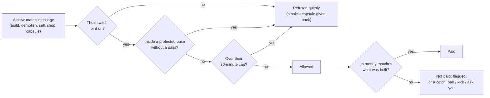

# Crew Tools

Host tools for **Moon Sweepers** crew games: what each crew-mate may do, where and how much, cheat catching, and the
host chores. **Only the host needs it**; crew-mates install nothing. A BepInEx 6 (IL2CPP) plugin, built on
[[Crew Permissions by tylerun|Credits]].

[Download the latest release](https://github.com/swheettaos/crewtools/releases/latest)

## Start here

| If you want to | Read |
|---|---|
| Install it, or move from Crew Permissions | [[Installing]] |
| Choose what each crew-mate may do, and keep them out of your bases | [[Permissions and Bases]] |
| Stop the team's money being drained | [[Spending Cap]] |
| Catch money cheats and cheat trainers | [[Anti-Cheat]] |
| Ban, unban, reclaim, clean up | [[Bans and Cleanup]] |
| Find your way around the window | [[The Crew Tools Window]] |
| Change a limit or a default | [[Settings]] |
| Keep it up to date | [[Updates]] |
| Fix something | [[Troubleshooting]] |
| Read it from a script or a tool | [[For Tools]] |

## How a crew-mate's action is judged

You (the host) are never restricted.
