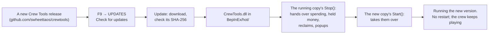

# With LunarLink

**Crew Tools runs on its own**: it's a normal BepInEx plugin, and everything on this wiki works without anything else.

**With [LunarLink](https://swheettaos.github.io/lunarlink/) it's hot-loadable and updates itself, in place, while the game runs.** LunarLink is a free
BepInEx plugin ([GitHub](https://github.com/swheettaos/lunarlink)) that loads plugins from `BepInEx/hot/`, reloads them without a restart, and updates
them from the game. Crew Tools is built for it.

## The advantages

| | On its own | With LunarLink |
|---|---|---|
| **Updating** | Download the new zip, close the game, unzip, start again | F9 → UPDATES → **Update**: downloaded from this repo's releases, checked against GitHub's SHA-256 and reloaded in place, **no restart** |
| **Your crew during an update** | Everyone leaves while you restart | Nobody notices: spending in the last 30 minutes, building money held, a ban reclaim in progress and unanswered cheating popups carry over to the new version |
| **Turning it off** | Remove the DLL and restart | F9 → HOT PLUGINS → **Disable**: unloaded from memory at once; **Enable** brings it back |
| **Scripts and tools** | - | HTTP requests under `/crew/` ([[For Tools]]), listed in LunarLink's `/help` and its F9 API tab |
| **An AI assistant** | - | Through LunarLink's [MCP server](https://github.com/swheettaos/lunarlink/wiki/MCP), Crew Tools' requests become tools: ask Claude "who's online, and has anyone been caught?" |
| **Seeing its state** | `BepInEx/LogOutput.log` | F9 shows it running, its build time, and any error |

## Setting it up

1. Install [LunarLink](https://github.com/swheettaos/lunarlink/releases/latest) (close the game, unzip into the game folder).
2. Put `CrewTools.dll` in **`BepInEx/hot/`**, and remove `BepInEx/plugins/CrewTools/` if you had it there. Not both:
   LunarLink refuses to load a second copy of a plugin BepInEx already loaded, and its BEPINEX PLUGINS tab won't turn on
   a copy of one that runs hot.
3. Start the game, load a moon, press **F9** → HOT PLUGINS, and **Enable** CrewTools (a new DLL starts off). It stays on
   from then on.
4. To update: F9 → UPDATES → **Check for updates** (or tick **Check for updates at game start**); the tab shows an orange
   count when a new Crew Tools is out, and the CrewTools row has an **Update** button.

## More about LunarLink

[Its site](https://swheettaos.github.io/lunarlink/) · [wiki](https://github.com/swheettaos/lunarlink/wiki) · [how updates work](https://github.com/swheettaos/lunarlink/wiki/Updates) · [hot plugins](https://github.com/swheettaos/lunarlink/wiki/Hot-Plugins) ·
[installing](https://github.com/swheettaos/lunarlink/wiki/Installing)
